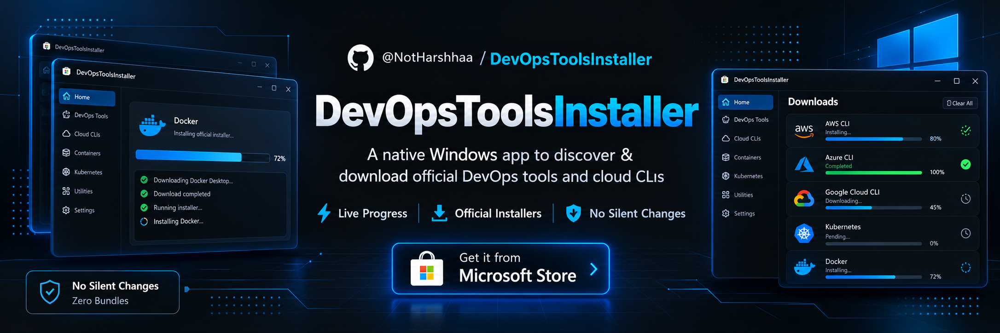

# DevOpsToolsInstaller

<p align="center">
  <em>Provision a complete DevOps workstation on Windows in minutes — 90 official tools, curated stacks,<br/>resumable downloads, headless automation, and a security-first pipeline. Zero silent installs, zero bundled binaries, zero telemetry.</em>
</p>

<p align="center">
  <a href="https://github.com/NotHarshhaa/DevOpsToolsInstaller/releases/latest"></a>
  <a href="https://apps.microsoft.com/detail/9PJL0VR3H7VG"></a>
  
  
  
  
  
  
  
  
</p>

<p align="center">
  <a href="https://apps.microsoft.com/detail/9PJL0VR3H7VG">
    
  </a>
</p>

<p align="center">
  
</p>

A high-performance, native Windows 11 desktop application (WinUI 3 + Mica Alt) designed to provision cloud, container, Kubernetes, IaC, security, database, and terminal tools on a fresh workstation in minutes — with the visual polish and the security posture of a first-party Windows app.

> [!NOTE]  
> DevOpsToolsInstaller does **not** install anything silently. It downloads official vendor artifacts directly from upstream release endpoints with real-time progress and **resumable transfers**, validates Authenticode digital signatures and SHA-256 hashes, tags downloads with Mark-of-the-Web so SmartScreen stays active, and triggers the appropriate context-aware action — launching the vendor's setup wizard, unpacking an archive, or placing a standalone CLI into an isolated user tools folder.

---

## ✨ Highlights

| | |
| :--- | :--- |
| 🪟 **Truly native Windows 11** | Mica Alt backdrop, Fluent `CommandBar` toolbars, your **own system accent color**, `InfoBadge` update counters, Segoe Fluent Icons — no custom theme hacks. |
| 📦 **90 official tools, 12 curated stacks** | Direct-from-vendor artifacts with role-based presets (Kubernetes, DevSecOps, Cloud, IaC, Observability, Terminal). |
| 🧱 **Custom Stack Builder** | 2-column composer: drag tool cards into "My Stack", reorder, inspect live download size estimates, save presets, and export/import `.json`. |
| 📋 **Project Manifest & CI Lockfile** | Team reproducible toolsets via `devtools.json` & `devtools.lock.json` — 1-click bootstrap or CI drift check (`--check`). |
| 🔀 **Side-by-Side Versions & Switcher** | Keep multiple CLI versions (e.g. `kubectl 1.29` & `1.31`, `terraform 1.8` & `1.9`) installed together and switch per-project (like `tfenv` or `nvm`). |
| 💻 **New-PC Workstation Migration** | Back up and restore toolsets and configs (`.gitconfig`, PowerShell profile, Windows Terminal settings, VS Code extensions, SSH config). |
| ☁️ **Cloud & Contexts Dashboard** | Monitor local AWS, Azure, and GCP login states, and switch active Kubernetes contexts in 1 click (like `kubectx`). |
| 🏢 **Teams & Enterprise Feeds** | Subscribe to private company tool catalogs with corporate approval badges, and enforce enterprise IT security policies. |
| 📦 **Air-Gapped Offline Bundles** | Export complete stacks to a USB drive with self-contained installer scripts (`install-offline.ps1` & `.cmd`) and Intune deployment scripts. |
| 🔄 **Optional Backends** | Choose `winget`, `Scoop`, or `Chocolatey` per-tool or globally while keeping direct vendor downloads as the default zero-bloat standard. |
| 🐧 **WSL Awareness & Prerequisite Fixes** | Detect installed WSL distros, probe tools inside Linux, and 1-click enable WSL2 and Virtual Machine Platform. |
| 🧭 **Visual PATH & Environment Manager** | Reorder PATH search precedence, clean dead and duplicate paths, set environment variables with live `WM_SETTINGCHANGE` broadcast. |
| 🔑 **Git & SSH Setup Wizard** | Configure Git identity and Credential Manager, generate modern Ed25519 SSH keys, copy public keys, and enable the Windows `ssh-agent`. |
| 💻 **Terminal & PowerShell Setup** | Windows Terminal profile and font customizer (Nerd Fonts), 1-click CLI tab completions, and curated DevOps aliases (`k`, `tf`, `d`, `dc`). |
| 🗂️ **Profiles, snapshots & rollback** | Capture named workstation profiles, diff and restore snapshots, review install history, and roll a tool back to a previous version — plus opt-in per-tool pre/post-install hooks. |
| 🩺 **Workstation Doctor** | 5-point environment diagnostics (PATH duplicates/conflicts, multi-version CLIs, missing prerequisites, stale versions) with 1-click confirmed fixes and markdown report export. |
| 🧾 **SBOM & Compliance Export** | Export every installed tool as a **CycloneDX 1.5** or **SPDX 2.3** Software Bill of Materials — versions, vendor download URLs, SHA-256 artifact hashes, declared licenses — from the UI or headless CLI. |
| 📋 **Global Live Log Drawer (`Ctrl+\``)** | Collapsible, resizable, virtualized drawer available across every page with live download, SHA-256, and signature verification events. |
| ⏯️ **Resumable download engine** | Interrupted transfers (dropped Wi-Fi, cancelled batches) continue via HTTP `Range` from a `.partial` file — large installers like Docker Desktop never restart from zero. |
| ♻️ **Storage & download cache manager** | Disk-usage breakdown of everything the app owns (download cache, extracted tools, audit logs), one-click safe cleanup with in-flight-transfer protection, and an opt-in startup auto-clean for stale artifacts. |
| 🛡️ **Security-first pipeline** | HTTPS-only fetches → SHA-256 verification → Authenticode `WinVerifyTrust` with a configurable **Warn / Block** policy → Mark-of-the-Web tagging → on-disk audit log → **cryptographically signed catalog** (fail-closed). |
| 🖥️ **Headless CLI mode** | Comprehensive CLI surface for scripts, machine provisioning, and CI pipelines with proper exit codes. |
| 🌐 **Corporate proxy support** | Point downloads, catalog updates, and update checks at your own proxy (Settings → Network) — handy behind corporate firewalls. |
| 📌 **System tray + update scheduler** | Close-to-tray with quick actions, background tool-update scans, maintenance windows, and toast notifications with release notes. |
| 🔍 **Zero trust, zero telemetry** | No analytics, no phone-home, no background services. Everything it does is logged locally and inspectable. |

---

## Contents

- [Why](#why)
- [Who This Is For](#who-this-is-for)
- [How It Works](#how-it-works)
- [Application Tour & Navigation](#application-tour--navigation)
- [Headless CLI Mode](#headless-cli-mode)
- [Tool Categories (90 Tools)](#tool-categories-90-tools)
- [Curated Stacks & Custom Stack Builder](#curated-stacks--custom-stack-builder)
- [Project Manifest & CI Lockfile (devtools.json)](#project-manifest--ci-lockfile-devtoolsjson)
- [Side-by-Side Versions & Switcher](#side-by-side-versions--switcher)
- [New-PC Workstation Migration](#new-pc-workstation-migration)
- [Cloud Connections & Kubernetes Contexts](#cloud-connections--kubernetes-contexts)
- [Teams & Enterprise Features](#teams--enterprise-features)
  - [Private Catalog Feeds](#private-catalog-feeds)
  - [Offline Air-Gapped Bundles & USB Export](#offline-air-gapped-bundles--usb-export)
  - [Enterprise IT Policy Engine & Intune Deployment](#enterprise-it-policy-engine--intune-deployment)
  - [Optional Package Manager Backends (winget, Scoop, Chocolatey)](#optional-package-manager-backends-winget-scoop-chocolatey)
- [Environment Setup & Workstation Hygiene](#environment-setup--workstation-hygiene)
  - [WSL Awareness & Virtualization Prerequisite Fixes](#wsl-awareness--virtualization-prerequisite-fixes)
  - [Visual PATH & Environment Variable Manager](#visual-path--environment-variable-manager)
  - [Git & SSH Setup Wizard](#git--ssh-setup-wizard)
  - [Windows Terminal & PowerShell Productivity](#windows-terminal--powershell-productivity)
- [Workstation Doctor & Environment Diagnostics](#workstation-doctor--environment-diagnostics)
- [Global Collapsible Log Drawer (Ctrl+`)](#global-collapsible-log-drawer-ctrl)
- [Keyboard Shortcuts, Empty States & Responsive Layout](#keyboard-shortcuts-empty-states--responsive-layout)
- [What Happens After Download](#what-happens-after-download)
- [Resumable Download Engine](#resumable-download-engine)
- [Storage & Download Cache Manager](#storage--download-cache-manager)
- [Installed Tools, Health Checks & Shell Completions](#installed-tools-health-checks--shell-completions)
- [Adding `Tools\bin` to Your PATH](#adding-toolsbin-to-your-path)
- [Security, Integrity & Privacy](#security-integrity--privacy)
- [In-App Auto-Updater & Tray](#in-app-auto-updater--tray)
- [Installation & Deployment Options](#installation--deployment-options)
- [Tech Stack](#tech-stack)
- [Roadmap](#roadmap)
- [Catalog Format, Signing & Custom Tools](#catalog-format-signing--custom-tools)
- [Troubleshooting](#troubleshooting)
- [FAQ](#faq)
- [Contributing](#contributing)
- [Changelog](CHANGELOG.md)
- [License](#license)

---

## Why

Setting up a new DevOps workstation usually means the same tedious routine: open a dozen browser tabs, chase down vendor download URLs, verify versions, extract archives, configure PATH variables, and run each setup by hand.

**DevOpsToolsInstaller** unifies this workflow into a single, beautifully designed workstation control plane:
- Browse an extensible catalog of **90 official developer and DevOps tools**.
- Choose role-based **Curated Stacks** for rapid 1-click provisioning or catalog filtering.
- Select previous release versions directly from tool cards.
- Install from a **script or terminal** with headless CLI commands and CI-friendly exit codes.
- Trust every byte: SHA-256 checksums, Authenticode signatures, HTTPS-only fetches, and a signed catalog.
- Enjoy a translucent **Windows 11 Mica Alt** interface that follows **your** accent color, with zero background bloat, zero telemetry, and zero hidden installs.

---

## Who This Is For

- **DevOps, Platform & SRE Engineers** setting up or reprovisioning Windows laptops.
- **Cloud Architects & Developers** working across AWS, Azure, GCP, and Kubernetes ecosystems.
- **IT & Security Teams** who need transparent vendor downloads, signature auditing, a configurable unsigned-installer policy, audit logs, and zero system tampering.
- **Automation & Provisioning Engineers** who want the same toolchain installs reproducible from a script.

---

## How It Works

```
┌─────────────────────────┐   Signed Catalog (ECDSA P-256)   ┌────────────────────────┐
│  DevOps Tools Catalog   │  ──────── verified ───────────►  │   Official Artifact    │
│  (90 Tools / 12 Stacks) │        HTTPS-only fetch          │  (.msi, .exe, .zip)   │
└─────────────────────────┘                                  └───────────┬────────────┘
                                                                         │
                                                Cryptographic Checks     ▼
                                  ┌──────────────────────────────────────────────────────┐
                                  │ SHA-256 Hash + Authenticode WinVerifyTrust + MOTW    │
                                  │ (signature policy: Warn before launch / Block)       │
                                  └───────────────────────────────┬──────────────────────┘
                                                                  │
                                  ┌───────────────────────────────┴──────────────────────┐
                                  ▼                                                      ▼
                      Installer (.msi / .exe)                        Archive / CLI Binary
                      Standard Vendor Wizard                        %LOCALAPPDATA%\...\Tools\bin
                      (User UAC Prompt)                             (1-Click User PATH Setup)
```

1. **Select Tools or Stacks** — in the UI, or from a terminal with `--install` / `--install-bundle`.
2. **Direct Official Download** — fetched straight from official vendor repositories (GitHub Releases, AWS, Azure, HashiCorp, CNCF) over HTTPS only, with automatic resume of interrupted transfers.
3. **Integrity Validation** — SHA-256 hash verification, Win32 `WinVerifyTrust` signature checks, configurable unsigned-installer policy, and Mark-of-the-Web tagging so Windows SmartScreen stays in the loop.
4. **Context-Aware Deployment** — launch official installers, extract archives, or deploy CLI binaries directly to your workstation.

---

## Application Tour & Navigation

The application uses the Windows 11 **Mica Alt** translucent canvas, **your system accent color** for all highlights and actions, native **Segoe Fluent Icons**, and a clean layered layout. Page state (search text, filters, selections, scroll positions) is preserved as you navigate — nothing resets when you hop between sections.

- **🏠 Home (`HomePage`)**: Workstation dashboard with live metrics (installed tools, updates available, active downloads, PATH health), an **Active Downloads** strip with per-tool progress, curated stack cards with install progress, an **Updates Available** section with one-click "Update all", and a Popular & Essential tools list with 1-click install.
- **📦 Tool Catalog (`CatalogPage`)**:
  - **90 Cataloged Tools**: Multi-category browsing with official vector SVG logos.
  - **Native `CommandBar` toolbar**: Sort, downloaded-only filter, presets, select/clear, profile import/export — with Fluent hover states and automatic overflow.
  - **Multi-Version Selector**: Switch between the latest version or specific previous releases with dynamic URL resolution.
  - **Category Filter Chips + Favorites (★)**: Instant filtering; star preferred tools.
  - **Profile Import & Export**: Export your tool selections to a `.json` profile file to share across teams or restore setups instantly.
  - **Active Stack Banner**: Interactive banner showing current stack filtering with a single-click "Clear Filter" action.
- **🚀 Curated Stacks & Custom Stack Builder (`StacksPage`)**:
  - **12 Curated Workstation Presets**: Role-based bundles with live installed-count badges, tool logo previews, 1-click batch install, and catalog customization.
  - **Custom Stack Builder**: Interactive 2-column composer (Segmented mode toggle) allowing engineers to build bespoke stacks:
    - Searchable tool catalog on the left with keyboard-friendly **"+ Add"** buttons.
    - Right-hand **"My Stack"** drop zone with drag-and-drop reordering, Up/Down controls, and <kbd>Delete</kbd> key removal.
    - Live metrics header displaying total tool count and estimated download size.
    - Local preset saving (`custom_stacks.json`), portable JSON Export/Import with catalog validation, and 1-click batch installation.
- **🩺 Workstation Doctor (`DoctorPage`)**:
  - Full workstation health and environment diagnostics across 5 critical categories:
    - PATH conflicts and duplicate entries.
    - Missing runtime prerequisites (e.g., WSL2, Hyper-V, virtualization).
    - Multiple conflicting versions of the same CLI on PATH.
    - Installed tools that are outdated relative to the catalog.
    - Tools installed in `%LOCALAPPDATA%\...\Tools\bin` that are missing from your PATH.
  - Asynchronous non-blocking scanning with live status badges (`Passed`, `Warnings`, `Failed`).
  - Interactive **Fix** actions that always prompt for confirmation before modifying environment settings, plus a **Copy Report** button for markdown diagnostics.
- **☁️ Cloud & Kubernetes Contexts (`CloudDashboardPage`)**:
  - Live local login inspection for **AWS** (credentials file, SSO session, caller identity), **Azure CLI** (`az account show`), and **Google Cloud CLI** (`gcloud auth list`).
  - **One-click Cloud Login**: launches interactive CLI login workflows (`aws configure / sso`, `az login`, `gcloud auth login`) directly from the app.
  - **Kubernetes Context Switcher**: reads local `~/.kube/config`, displays the active cluster and namespace, lists all available contexts with server URLs, and switches contexts instantaneously with zero terminal typing (like `kubectx`).
- **🌿 Workstation Environment Setup (`EnvironmentPage`)** — a 4-tab workstation configuration workspace:
  - **🐧 WSL & Virtualization**: Detects all installed WSL distributions (e.g. Ubuntu, Debian) and default status; probes DevOps CLI availability inside Linux; and checks Windows Virtual Machine Platform with 1-click elevated PowerShell remediation.
  - **🧭 PATH & Environment Variables**: Visual PATH manager with up/down reordering, dead path detection, duplicate cleaning, and user variable creation with instantaneous system-wide `WM_SETTINGCHANGE` broadcast.
  - **🔑 Git & SSH Wizard**: Inspects global `user.name`, `user.email`, and Git Credential Manager; generates modern cryptographic **Ed25519** SSH keys; displays and copies public keys; and enables/starts the native Windows `ssh-agent` service.
  - **💻 Terminal & PowerShell**: Customizes Windows Terminal profiles and Nerd Fonts (e.g., Cascadia Code NF, JetBrains Mono NF); generates CLI autocompletion snippets into `$PROFILE`; and injects curated DevOps aliases (`k`, `tf`, `d`, `dc`).
- **📋 Collapsible Live Log Drawer (Universal, `Ctrl+\``)**:
  - Slide-up bottom drawer accessible across every page via button toggle or global <kbd>Ctrl</kbd>+<kbd>`</kbd> shortcut.
  - Resizable height (persisted in user preferences) with high-performance list virtualization for thousands of lines.
  - Live streams download events, SHA-256 verifications, Authenticode checks, and install outcomes.
  - Features real-time text search, severity filter (`All`, `Info`, `Warn`, `Error`), pause auto-scroll toggle, and clipboard copy.
  - Respects your system accent color and the Windows *Reduce animations* setting.
- **📥 Downloads (`DownloadsPage`)**: Concurrent download manager (up to 3 parallel transfers) with live speeds, percentages, Authenticode signature badges, status filter chips, an in-app **Activity & Diagnostic Log**, and post-download action triggers.
- **🩺 Installed Tools (`InstalledPage`)**:
  - Complete inventory with a native **InfoBadge update counter** on the navigation item.
  - **CLI Health Probing**: Executes binaries (`--version` / `-v`) to measure latency (ms) and verify runtime health.
  - **One-click tool updates** that download **and** run the vendor installer.
  - **Side-by-Side Version Switcher**: Inspect installed versions of multi-version CLIs (e.g., Terraform, kubectl) and switch active versions per project or globally.
  - **Project Manifest Integration**: Automatically scans open workspace folders for `.terraform-version`, `.nvmrc`, or `devtools.json` and prompts or switches active CLI versions.
  - **Shell Autocompletion Generator**: Generates autocompletion scripts for PowerShell and Bash with 1-click insertion into `$PROFILE`.
  - **Safe Uninstallation**: Invokes vendor uninstallers via Windows Registry detection or cleanly removes extracted files.
- **⚙️ Settings (`SettingsPage`)**:
  - Theme customization (Light, Dark, or System Default) using **your Windows accent color**.
  - **Security section**: installer signature policy (Warn / Block unsigned), always-on protections summary, and one-click access to the audit log folder.
  - **Enterprise IT Policy**: Status card showing compliance with `policy.json` (signature enforcement, allowed feed URLs, blocked tools); includes one-click export for Intune PowerShell deployment scripts.
  - **Private Catalog Feeds**: Subscribe to corporate repository URLs (e.g., `https://raw.githubusercontent.com/company/tools/main/catalog.json`) with corporate approval badges and automatic catalog merging.
  - **Alternative Backends**: Select between direct vendor downloads (default), `winget`, `Scoop`, or `Chocolatey` for specific tools or globally.
  - **Update Automation & Maintenance Windows**: Background tool-update scanning interval (1 hr, 6 hrs, 24 hrs), toast alerts with changelog notes, version pinning/ignoring, and off-peak maintenance installation windows.
  - **Toast Notifications & Close-to-Tray toggles**.
  - **Hooks & Automation**: opt-in toggle for user-authored pre/post-install shell commands. Nothing runs unless it is enabled here, every command is written to the activity & audit log before it executes, and commands support placeholders such as `{tool}`, `{toolId}`, `{version}`, `{file}`, `{toolsBin}`, and `{toolsRoot}`.
  - One-click **"Add to PATH"** with real-time PATH inspection.
  - Disk cache monitor and cleanup; desktop and Start Menu shortcut creation.
  - Manual **"Check for Updates"** triggering the GitHub update service.
- **🗂️ Profiles & History (`ProfilesPage`)** — a Segmented workspace with five sections:
  - **Profiles**: capture the currently installed toolset (or the current catalog selection) as a named profile; **Apply** it to the catalog filter, **Install** every tool it contains in one click, and **Import/Export** profiles as portable JSON.
  - **Snapshots**: point-in-time restore points recording installed tools, their versions, and User PATH — with a **Diff** view (missing / version-changed / added) and one-click **Restore** of missing tools.
  - **New-PC Workstation Migration**: Bundle tools and developer workstation configs (`.gitconfig`, PowerShell `$PROFILE`, Windows Terminal `settings.json`, VS Code extension list, and `~/.ssh/config` — never private keys) into a single portable migration package to configure a new laptop in under 5 minutes.
  - **History**: a persistent log of every install, update, uninstall, and rollback, plus a guided **Roll back a tool…** flow that re-downloads and reinstalls a previously recorded version.
  - **Sync**: opt-in merge of profiles, snapshots, hooks, and custom tools across machines through a OneDrive / Dropbox / network folder — no account, no server, zero telemetry.
- **🛠️ Custom Tools (`CatalogEditorPage`)**: author and validate your own catalog entries (id, kind, download URL, SHA-256, logo, launch args), import/export a custom `catalog.json` feed, and merge them into the live catalog so they behave exactly like shipped tools.
- **📌 System Tray**: Close the window to keep the app running in the tray (toggle in Settings). Left-click restores the window; right-click offers **Open**, **Open Tool Catalog**, **Check for tool updates**, and **Exit**.
- **🔔 Toast Notifications**: Background installs, batch downloads, and update checks surface Windows toasts (toggle in Settings; delivery is best-effort and never interrupts the workflow).
- **ℹ️ About (`AboutPage`)**: Architecture specifications, workstation diagnostics, complete **Security Risks & Precautions**, and legal trademark disclaimers.
- **🔍 Global AutoSuggestBox**: Embedded directly in the left navigation pane for real-time catalog search and direct query forwarding from anywhere in the app.

---

## Headless CLI Mode

Everything the UI does is scriptable. Point it at a fresh machine, a rebuild script, or a CI job — the process attaches to your terminal, prints progress, and exits with meaningful codes.

```text
PS> DevOpsToolsInstaller.exe --list
DevOps Tools Installer v3.0.0 — 90 tools available

  act                      act                          CI/CD and Version Control
  dagger                   Dagger                       CI/CD and Version Control
  git                      Git for Windows              CI/CD and Version Control
  ...

PS> DevOpsToolsInstaller.exe --install kubectl,terraform,helm
[get ] kubectl (kubectl.exe)
       kubectl: 74%
[ok  ] kubectl: copied to Tools\bin. It's on your PATH and ready to use.
...

PS> DevOpsToolsInstaller.exe --manifest ./devtools.json
[manifest] Installing project dependencies: kubectl (v1.31.0), terraform (v1.9.5)
[ok] Active version switched: terraform -> 1.9.5

PS> DevOpsToolsInstaller.exe --check ./devtools.lock.json
[ci] Verifying installed tools against lockfile...
[ok] kubectl: installed v1.31.0 matches lockfile (sha256 verified)
[ok] terraform: installed v1.9.5 matches lockfile (sha256 verified)
CI Drift Check Passed. Exit 0.

PS> DevOpsToolsInstaller.exe --cloud-status
[cloud] AWS: Logged in (Account: 123456789012, User: dev-harsh)
[cloud] Azure: Logged in (Subscription: Production-EastUS)
[cloud] GCP: Active account (dev@company.com, Project: platform-prod)
[kube] Active Context: eks-prod-cluster (Namespace: default)
```

| Command | Description |
| :--- | :--- |
| **Catalog & Installation** | |
| `--list` | List every tool in the catalog (id, name, category). |
| `--status` | Show which catalog tools are installed, with detected versions. |
| `--install <id,id,...>` | Download and install specific tools (skips already-installed). |
| `--install-bundle <bundleId>` | Install every tool in a curated stack. |
| `--update [id,id,...]` | Update outdated tools; with ids, force-refresh specific tools. |
| `--uninstall <id,id,...>` | Uninstall specific tools (removes artifacts, launches vendor uninstallers). |
| `--download-only <id,id,...>` | Download artifacts without installing (offline caching). |
| `--download-only-bundle <bundleId>` | Pre-download a curated stack for offline machines. |
| `--downloads-folder <path>` | Redirect downloads (e.g. a USB drive) for this run. |
| `--run-hooks` | Allow pre/post-install hooks to run during this CLI session (off by default). |
| **Project Manifest & CI Drift** | |
| `--manifest [file]` | Install required project tools & exact versions defined in `devtools.json`. |
| `--check [file]` | CI drift check: verifies installed tools match `devtools.lock.json` (fails with exit code 1 on mismatch). |
| `--export-manifest [file]` | Export current workstation tools into a reproducible `devtools.json` & lockfile. |
| **Side-by-Side Version Switcher** | |
| `--versions [toolId]` | List all installed versions of a multi-version CLI (e.g. Terraform, kubectl). |
| `--switch <tool> <version>` | Atomically switch the active CLI symlink/shim on PATH (like `tfenv` or `nvm`). |
| `--detect-project [dir]` | Scan directory for `.terraform-version`, `.nvmrc`, etc., and switch active CLI versions. |
| **New-PC Migration & Profiles** | |
| `--export-migration <file>` | Export complete New-PC package (installed tools + `.gitconfig`, PowerShell profile, Terminal, VS Code extensions, SSH config). |
| `--apply-migration <file>` | Restore migration package on a fresh laptop in under 5 minutes. |
| `--profiles` | List saved workstation profiles. |
| `--capture-profile <name>` | Save the currently installed toolset as a named profile. |
| `--apply-profile <name\|id>` | Select and install every tool in a profile. |
| `--sync-profiles` | Merge profiles, snapshots, hooks, and custom tools with the configured sync folder. |
| `--export-profile <file>` | Export installed tools to a lightweight JSON profile. |
| `--import-profile <file>` | Install tools from a JSON profile (skips already-installed). |
| `--import-winget <file>` | Migrate packages from a `winget export` JSON (best-effort id mapping). |
| `--import-choco <file>` | Migrate packages from chocolatey `list` output. |
| **Cloud & Kubernetes Contexts** | |
| `--cloud-status` | Display local authentication status for AWS, Azure, GCP, and active Kubernetes context. |
| `--kube-context [name]` | List available Kubernetes contexts or switch active context (like `kubectx`). |
| **Teams & Enterprise** | |
| `--list-feeds` | Display active private catalog feeds and their corporate approval status. |
| `--add-feed <name> <url>` | Subscribe to an enterprise internal catalog feed URL. |
| `--sync-feeds` | Force refresh and re-merge all private feed catalogs. |
| `--export-offline-bundle <bundleId> [dir]` | Bundle installers, SHA-256 manifests, and bootstrap script for air-gapped / USB transfer. |
| `--install-offline-bundle <dir>` | Install tools from an offline air-gapped bundle directory. |
| `--check-policy` | Audit workstation configuration against corporate `policy.json`. |
| `--export-policy-template <file>` | Generate an enterprise IT policy template JSON. |
| `--export-intune-script <file>` | Export an enterprise Microsoft Intune / Group Policy PowerShell remediation script. |
| `--backends` | List supported package manager backends (vendor, winget, scoop, choco) and availability. |
| `--backend <toolId> <backend>` | Set the preferred backend for a tool (e.g., `--backend terraform winget`). |
| **Environment & Workstation Hygiene** | |
| `--wsl` | Check WSL2, Hyper-V, and Virtual Machine Platform health. |
| `--wsl-tools` | Probe DevOps tool availability across installed WSL Linux distros. |
| `--wsl-fix` | Output elevated PowerShell script to enable required virtualization prerequisites. |
| `--env` | Display User PATH directory ordering, broken paths, and environment variables. |
| `--set-env <name> <val>` | Set a User environment variable with immediate `WM_SETTINGCHANGE` broadcast. |
| `--del-env <name>` | Remove a User environment variable. |
| `--git-status` | Inspect global Git config (`user.name`, `user.email`), GCM, SSH keys, and `ssh-agent`. |
| `--setup-git <name> <email>` | Configure global Git identity and Git Credential Manager. |
| `--generate-ssh-key [email]` | Generate a modern, secure Ed25519 SSH keypair (`~/.ssh/id_ed25519`). |
| `--setup-powershell` | Inject fast DevOps CLI autocompletions and productivity aliases into `$PROFILE`. |
| **Doctor, Snapshots & Automation** | |
| `--path-doctor` | Inspect User PATH for duplicate entries, non-existent directories, and missing tools folder. |
| `--fix-path` | Automatically clean and deduplicate User PATH with timestamped backup. |
| `--report <file>` | Write a markdown workstation report — installed tools, versions, pending updates, security settings. |
| `--sbom <file>` | Export installed tools as a standards-compliant SBOM (CycloneDX 1.5 by default; `--sbom-format spdx` for SPDX 2.3). |
| `--history [toolId]` | Print the install/update/uninstall/rollback history (optionally filtered to one tool). |
| `--snapshot <name>` | Capture a workstation snapshot (installed tools, versions, User PATH) as a restore point. |
| `--restore-snapshot <name>` | Install the tools missing relative to a saved snapshot. |
| `--check-updates` | Check for tool updates and print release notes. |
| `--storage` | Disk-usage report of the app's folders (download cache, tools, audit logs) and what cleanup could reclaim. |
| `--clean-downloads [scope]` | Safely clean the download cache: `partial` (interrupted resume state, default), `old` (artifacts >30 days), `all`. Never touches in-flight transfers or installed tools. |
| `--generate-script <file>` | Generate a standalone PowerShell bootstrap script for the current tool set. |
| `--generate-devcontainer <zip/dir>` | Generate a VS Code `.devcontainer/devcontainer.json` and `Dockerfile` matching workstation tools. |
| `--version` | Print the application version. |
| `--help` | Show usage. |

> **Workstation profiles:** run `--export-profile profile.json` on a configured machine, commit the file,
> then `--import-profile profile.json` (or the generated `--generate-script bootstrap.ps1`) on a fresh one.
> The generated script is fully standalone — it re-downloads official vendor artifacts and needs no
> DevOpsToolsInstaller installation on the target machine.

- **Exit codes**: `0` = success, `1` = one or more tools failed — perfect for provisioning scripts.
- **Already installed** tools are detected and skipped automatically.
- Vendor installers still run interactively (their own wizard + UAC) exactly like in the UI — nothing bypasses your security policy in headless mode.

---

## Tool Categories (90 Tools)

The catalog organizes 90 essential tools across 12 distinct domains:

1. **Cloud Provider CLIs**: AWS CLI, Azure CLI, Google Cloud CLI, OCI CLI, AWS SAM CLI, eksctl, Azure Functions Core Tools.
2. **Containerization & Runtimes**: Docker Desktop, Podman Desktop, Lazydocker, Dive, Kind, Minikube.
3. **Kubernetes Tooling**: kubectl, Helm, k9s, Stern, Kustomize, kubectx, kubens, Helmfile, Cilium CLI, Linkerd, Istioctl, Velero.
4. **Infrastructure as Code (IaC)**: Terraform, OpenTofu, Pulumi, Terragrunt, TFLint, Packer, Ansible, Infracost.
5. **CI/CD & Version Control**: Git, GitHub CLI, GitLab CLI, ArgoCD CLI, Flux CLI, Tekton CLI (`tkn`), Act (local GitHub Actions runner), Dagger, Task.
6. **Security & Secrets Management**: HashiCorp Vault, SOPS, Gitleaks, Snyk CLI, Kyverno CLI.
7. **Policy, Governance & Compliance**: Trivy, Checkov, tfsec, Syft, Grype, Cosign, Open Policy Agent (`opa`).
8. **Networking & Tunneling**: ngrok, Cloudflare Tunnel (`cloudflared`), Tailscale, Wireshark, Nmap, ctop.
9. **Database & Data DevOps**: Flyway CLI, Liquibase, pgcli, mycli, usql, Redis CLI.
10. **Monitoring & Observability**: Prometheus, Grafana, k6 (load testing), Vector, LogCLI.
11. **Developer Editors & Terminals**: Visual Studio Code, Windows Terminal, PyCharm Community, Cursor, Neovim.
12. **Core Utilities & Performance**: jq, yq, Postman, curl, HTTPie, Starship, fzf, ripgrep, bat, fd, eza, zoxide, Delta, PuTTY, WinSCP, 7-Zip.

*(Full specifications live in [`catalog/catalog.json`](catalog/catalog.json).)*

---

## Curated Stacks & Workstation Presets

The **Curated Stacks** section offers 12 opinionated, battle-tested bundles designed to provision a machine for specific engineering disciplines:

| Stack | Description | Core Tools Included |
| :--- | :--- | :--- |
| **Kubernetes Starter Pack** | Core toolset for local and remote cluster management | `kubectl`, `helm`, `k9s`, `minikube`, `stern`, `kustomize`, `kubectx` |
| **Kubernetes Advanced** | Production GitOps, service mesh, and disaster recovery | `kubectl`, `helm`, `argocd`, `flux`, `istioctl`, `cilium-cli`, `velero`, `helmfile`, `k9s` |
| **Cloud Engineer Essentials** | Multi-cloud infrastructure and policy provisioning | `awscli`, `azure-cli`, `gcloud-cli`, `terraform`, `terragrunt`, `tflint`, `infracost`, `vault` |
| **AWS Developer Kit** | Toolkit for AWS cloud, containers, and serverless | `awscli`, `aws-sam-cli`, `eksctl`, `terraform`, `docker-desktop` |
| **DevSecOps Toolkit** | Vulnerability scanning, container signing, and policy auditing | `trivy`, `gitleaks`, `sops`, `cosign`, `syft`, `grype`, `opa`, `kyverno-cli` |
| **CI/CD Pipeline Builder** | Local runner automation and pipeline construction | `git`, `github-cli`, `act`, `dagger`, `task`, `docker-desktop`, `tkn` |
| **IaC Complete** | Comprehensive infrastructure-as-code suite | `terraform`, `opentofu`, `pulumi`, `terragrunt`, `tflint`, `packer`, `vault`, `infracost` |
| **Observability Stack** | Metrics, distributed logging, and performance benchmarking | `prometheus`, `grafana`, `k6`, `vector`, `logcli` |
| **Terminal Power User** | Blazing-fast modern CLI productivity enhancements | `windows-terminal`, `starship`, `fzf`, `ripgrep`, `bat`, `fd`, `eza`, `zoxide`, `delta`, `jq`, `yq` |
| **Container Essentials** | Container build, debug, and vulnerability inspection | `docker-desktop`, `lazydocker`, `dive`, `trivy`, `cosign`, `syft` |
| **Developer Workstation** | Complete one-click bootstrap for a fresh developer machine | `git`, `github-cli`, `vscode`, `docker-desktop`, `kubectl`, `helm`, `terraform`, `jq`, `postman`, `windows-terminal`, `starship` |
| **Networking & Service Mesh** | Secure ingress tunneling and service-to-service networking | `ngrok`, `cloudflared`, `linkerd`, `istioctl`, `cilium-cli` |

### Dual-Action Workflow
- **Install Stack**: Queues and batch-downloads every tool in the stack (skipping anything already installed) and jumps you to live progress.
- **Select Stack / Customize in Catalog**: Applies a live filter to the Catalog, enabling you to review, customize, or selectively install tools in the stack.
- **Open in Stack Builder**: Loads any curated stack directly into the interactive builder for instant personalization.

> [!TIP]
> Use **"Select Stack"** to preview tools in the catalog, or click **"Open in Stack Builder"** from any stack card's menu to tweak tools before installation.

---

### Custom Stack Builder

Build, share, and deploy tailored workstation configurations using the integrated **Custom Stack Builder** directly on `StacksPage`:

<p align="center">
  <em>Toggle between "Presets" and "Stack Builder" in the Stacks header to compose custom toolsets.</em>
</p>

1. **Two-Column Responsive Layout**:
   - **Catalog Browser (Left)**: Live search filter (`AutoSuggestBox`), category badges, vector logos, and accessible **"+ Add"** buttons.
   - **My Stack Composer (Right)**: Drag-and-drop landing area with editable stack metadata, reorderable items, and action controls.
2. **Intuitive Drag, Reorder & Removal**:
   - Drag tool cards from the catalog into the stack area.
   - Drag items within "My Stack" to reorder, or use the dedicated **Move Up** (``) and **Move Down** (``) controls.
   - Remove tools with the red **Remove** (``) button or by selecting an item and pressing <kbd>Delete</kbd>.
3. **Live Metrics Summary**:
   - Displays real-time **Total Tools Count** and **Estimated Download Size**.
   - Estimates automatically account for already-cached local installers and package types (`Installer`, `Archive`, `Binary`).
4. **Save, Export & Import**:
   - **Save**: Saves locally to `%LOCALAPPDATA%\DevOpsToolsInstaller\custom_stacks.json`. Custom stacks appear in your presets grid across app launches.
   - **Export (.json)**: Generates a lightweight, version-controlled JSON stack definition to share with teammates.
   - **Import (.json)**: Validates imported files against the tool catalog. Unknown or deprecated tool IDs are cleanly skipped, and an `InfoBar` notifies you of what was loaded and any unrecognized IDs.
5. **One-Click Installation**:
   - Click **Install This Stack** to automatically resolve uninstalled tools, enqueue them into the download pipeline, respect off-peak schedules, and navigate directly to the Downloads page with live progress.
6. **Full Keyboard Accessibility**:
   - Use the **"+ Add"** button on any catalog card for 100% keyboard-only stack assembly.

---

## Project Manifest & CI Lockfile (devtools.json)

Transform DevOpsToolsInstaller from a personal installer into a unified team standardization platform. Store a lightweight `devtools.json` manifest in any repository root to declare the exact tools and versions required by the project, alongside a cryptographically pinned `devtools.lock.json` lockfile.

### 📋 How It Works

```
Repository Root
 ├── devtools.json         <- Declares required tools & semantic version constraints
 ├── devtools.lock.json    <- Pinned exact versions, SHA-256 checksums, and artifact sources
 └── .github/workflows/
      └── ci.yml           <- Verifies tool versions before build/test runs
```

#### Sample `devtools.json`
```json
{
  "$schema": "https://raw.githubusercontent.com/NotHarshhaa/DevOpsToolsInstaller/main/schema/devtools.schema.json",
  "name": "platform-infrastructure",
  "description": "Cloud platform provisioning & Kubernetes management toolchain",
  "tools": {
    "kubectl": "1.31.0",
    "helm": "^3.15.0",
    "terraform": "1.9.5",
    "k9s": "latest",
    "trivy": "latest"
  }
}
```

#### Sample `devtools.lock.json`
```json
{
  "lockfileVersion": 1,
  "generated": "2026-10-23T12:00:00Z",
  "tools": {
    "kubectl": {
      "version": "1.31.0",
      "sha256": "4b5d6f...",
      "source": "https://dl.k8s.io/release/v1.31.0/bin/windows/amd64/kubectl.exe"
    },
    "terraform": {
      "version": "1.9.5",
      "sha256": "3a92b1...",
      "source": "https://releases.hashicorp.com/terraform/1.9.5/terraform_1.9.5_windows_amd64.zip"
    }
  }
}
```

### ⚡ One-Click Developer Onboarding
When a developer opens a project containing `devtools.json`, the app automatically surfaces an **"Install what this project needs"** prompt. In a single click:
1. Missing tools are batch-downloaded and verified against the lockfile hashes.
2. Tools with side-by-side versions are automatically switched to match the declared project version.
3. The developer is fully onboarded and ready to run infrastructure pipelines in minutes.

### 🛡️ CI Toolchain Drift Check
Prevent *"works on my machine"* drift across team members and CI agents. Add a simple check step in your GitHub Actions or Azure Pipelines workflow:

```yaml
- name: Verify DevOps Toolchain Drift
  run: |
    .\DevOpsToolsInstaller.exe --check devtools.lock.json
```
If any tool is missing, outdated, or altered, the command prints the exact drift details and exits with code `1`, failing the job before broken infrastructure changes can reach production.

---

## Side-by-Side Versions & Switcher

DevOps engineers frequently juggle multiple clusters and infrastructure environments requiring different CLI versions — such as `kubectl` 1.29 for legacy clusters and 1.31 for modern environments, or Terraform 1.5.7 (pre-BSL) and 1.9.5.

DevOpsToolsInstaller solves this natively without external shims or third-party package manager bloat:

- **Isolated Version Storage**: Each installed version is preserved in `%LOCALAPPDATA%\DevOpsToolsInstaller\Tools\versions\<tool>\<version>\`.
- **Atomic Version Switching**: An active symlink or shim in `Tools\bin` points to your chosen active release. Switching versions is instantaneous and atomic.
- **Works like `tfenv` and `nvm`**: Switch active versions on demand via GUI or terminal:
  ```powershell
  # List all installed versions
  DevOpsToolsInstaller.exe --versions terraform

  # Switch active version immediately
  DevOpsToolsInstaller.exe --switch terraform 1.9.5
  ```
- **Automatic Project Detection**: When navigating into a folder containing `.terraform-version`, `.nvmrc`, `.kubectl-version`, or `devtools.json`, the CLI and UI auto-detect the required version and offer 1-click activation.

---

## New-PC Workstation Migration

*"Set up my new laptop"* is a headline DevOps use case. Beyond installing binaries, modern developer workflows depend heavily on personalized configurations and terminal environments.

DevOpsToolsInstaller captures your complete developer workstation state into an encrypted, portable migration bundle (`.dtimigrate`):

| Component | What Is Migrated | Security Handling |
| :--- | :--- | :--- |
| **Installed Tools & Versions** | Full inventory of cataloged tools, custom tools, and installed versions. | Exact SHA-256 validation on restore. |
| **Git Configuration** | Global `.gitconfig` (user identity, aliases, diff tools, credential helpers). | Preserves global formatting. |
| **PowerShell Environment** | PowerShell `$PROFILE` (custom prompts, utility functions, module imports). | Restores to `$PROFILE` with automatic backup. |
| **Windows Terminal Settings** | `settings.json` (color schemes, custom profiles, Nerd Font bindings, acrylic). | Applied cleanly across Terminal installations. |
| **VS Code Extensions** | Comprehensive extension identifier list (`publisher.extension`). | Re-installed automatically via `code --install-extension`. |
| **SSH Client Config** | Host aliases, ProxyJump configurations, identity file directives (`~/.ssh/config`). | **Zero Private Keys:** Private keys (`id_rsa`, `id_ed25519`) are strictly ignored and never exported. |

### Export & Restore Workflow
```powershell
# On your existing workstation:
DevOpsToolsInstaller.exe --export-migration my-workstation.dtimigrate

# On your brand-new laptop:
DevOpsToolsInstaller.exe --apply-migration my-workstation.dtimigrate
```
The entire restore process takes under 5 minutes and creates timestamped backups (`*.bak`) of any pre-existing local configuration files before updating them.

---

## Cloud Connections & Kubernetes Contexts

DevOps engineers shouldn't have to toggle between three vendor CLIs and complex terminal commands just to find out where their machine is logged in.

The **Cloud Connections Dashboard** (`CloudDashboardPage`) provides a unified, real-time command center:

```
┌────────────────────────────────────────────────────────────────────────┐
│ ☁️ Cloud & Kubernetes Contexts                                          │
├───────────────────┬────────────────────┬──────────────────┬────────────┤
│ 🟧 AWS CLI        │ 🟦 Azure CLI       │ 🟥 Google Cloud  │ ☸️ Kubectl │
│ Logged In         │ Logged In          │ Active Account   │ Context:   │
│ Account: 1234...  │ Sub: Prod-EastUS   │ dev@company.com  │ eks-prod   │
│ Role: DevOpsAdmin │ Tenant: 7b8c...    │ Proj: infra-prod │ (Default)  │
│ [Open SSO / Conf] │ [Run 'az login']   │ [Run 'gcloud..'] │ [Switch ▾] │
└───────────────────┴────────────────────┴──────────────────┴────────────┘
```

- **Local State Inspection Only**: Reads local files and CLI state (`~/.aws/credentials`, `~/.aws/config`, `az account show`, `gcloud auth list`, `~/.kube/config`). Zero credentials leave your workstation.
- **One-Click Cloud Login**: Launch interactive vendor login flows (`aws configure / sso`, `az login`, `gcloud auth login`) directly from the UI.
- **Instant Kubernetes Context Switcher (kubectx)**:
  - Scans all configured clusters and contexts in `~/.kube/config`.
  - Displays the active cluster, active namespace, and cluster API endpoint.
  - Switch contexts with a single click or CLI command:
    ```powershell
    DevOpsToolsInstaller.exe --kube-context eks-production-east
    ```

---

## Teams & Enterprise Features

Equip enterprise IT and platform engineering teams with governance, offline air-gapped readiness, and flexible package management.

### Private Catalog Feeds
Subscribe to internal company repository URLs hosting proprietary tools, internal CLI plugins, or organization-approved configurations:
- Add remote or intranet feed URLs (e.g., `https://git.company.internal/devtools/catalog.json`).
- Shipped tools display standard catalog badges; tools distributed via private corporate feeds display a **Corporate Feed** verification badge.
- CLI commands: `--list-feeds`, `--add-feed <name> <url>`, `--sync-feeds`.

### Offline Air-Gapped Bundles & USB Export
Provision machines in air-gapped environments, secure SCIF facilities, or data center jumpboxes without internet access:
- Export any curated stack or custom toolset to a portable directory or USB drive:
  ```powershell
  DevOpsToolsInstaller.exe --export-offline-bundle k8s-starter D:\AirGapTools
  ```
- Generates an offline package containing:
  - Verified installer and archive binaries.
  - Cryptographic SHA-256 verification manifest (`bundle-manifest.json`).
  - Self-contained bootstrap script (`install-offline.ps1`) for standalone execution without pre-installing the application.
- Restore on the offline machine:
  ```powershell
  DevOpsToolsInstaller.exe --install-offline-bundle D:\AirGapTools
  ```

### Enterprise IT Policy Engine & Intune Deployment
Centrally govern developer machine configurations and enforce compliance via enterprise policy (`policy.json`):
- **Signature Enforcement**: Force `BlockUnsigned` to disallow unverified vendor installers.
- **Feed Whitelisting**: Restrict custom catalog sources strictly to enterprise domain names.
- **Tool Blacklisting**: Prevent installation of prohibited binaries.
- **Microsoft Intune & Group Policy Export**: Generate one-click PowerShell deployment scripts configured for Intune Proactive Remediations:
  ```powershell
  DevOpsToolsInstaller.exe --export-intune-script ./Deploy-DevOpsPolicy.ps1
  ```

### Optional Package Manager Backends (winget, Scoop, Chocolatey)
While direct vendor downloads remain the default for maximum speed, security, and zero bloat, enterprise developers can opt into alternative package managers:
- Choose your preferred installation backend per-tool or globally:
  - **Vendor (Default)**: Direct HTTPS vendor download with SHA-256 and Authenticode validation.
  - **WinGet**: Native Windows Package Manager.
  - **Scoop**: Portable developer shim installer.
  - **Chocolatey**: Classic Windows package manager.
- Inspect and configure backends via CLI:
  ```powershell
  DevOpsToolsInstaller.exe --backends
  DevOpsToolsInstaller.exe --backend terraform winget
  ```

---

## Environment Setup & Workstation Hygiene

A clean workstation requires more than just downloaded binaries. The **Environment Setup** workspace (`EnvironmentPage`) provides dedicated tools for foundational developer hygiene:

### WSL Awareness & Virtualization Prerequisite Fixes
- **Distro Discovery**: Detects all installed WSL distributions (Ubuntu, Debian, openSUSE, Kali Linux) and highlights your default distro.
- **Cross-Environment Tool Probing**: Verifies whether DevOps CLIs (`docker`, `kubectl`, `git`, `terraform`) are installed inside your Linux distros.
- **1-Click Virtualization Remediation**: Diagnoses whether WSL2, Virtual Machine Platform, or Hyper-V are missing, and generates an elevated PowerShell fix script to activate required Windows features.

### Visual PATH & Environment Variable Manager
Diagnose and repair PATH issues without digging through the legacy Windows Control Panel:
- **Visual Precedence Reordering**: Move directories up or down to adjust CLI execution priority.
- **Dead & Duplicate Cleanup**: Automatically highlights deleted directories and redundant entries for 1-click removal.
- **Instant System-Wide Broadcast**: Applying changes broadcasts a native Win32 `WM_SETTINGCHANGE` message (`HWND_BROADCAST`), updating newly opened terminals without requiring a system reboot.
- **CLI Commands**: `--env`, `--set-env <name> <val>`, `--del-env <name>`.

### Git & SSH Setup Wizard
Accelerate new developer Git configuration:
- **Git Identity Inspection**: Verifies `user.name`, `user.email`, and Git Credential Manager status.
- **Modern Ed25519 Key Generator**: Creates secure, high-performance Ed25519 SSH keypairs (`~/.ssh/id_ed25519`) with customizable comment metadata.
- **1-Click Public Key Copy**: Copies your public key to clipboard ready for GitHub, GitLab, or Bitbucket.
- **Windows `ssh-agent` Activation**: Configures and starts the native Windows OpenSSH Authentication Agent service (`ssh-agent`) and loads your newly generated key.

### Windows Terminal & PowerShell Productivity
Maximize developer terminal ergonomics:
- **Terminal Profile Configuration**: Customize default shell, starting directory, and color scheme.
- **Nerd Font Selector**: Inspect and select installed Nerd Fonts (Cascadia Code NF, JetBrains Mono NF, MesloLGS NF) for rich Starship and terminal glyph rendering.
- **Shell Autocompletions**: One-click append CLI completion scripts for `kubectl`, `helm`, `terraform`, `docker`, and `gh` directly to `$PROFILE`.
- **Curated DevOps Aliases**: Inject battle-tested CLI shortcuts into PowerShell:
  - `k` ➔ `kubectl`
  - `tf` ➔ `terraform`
  - `d` ➔ `docker`
  - `dc` ➔ `docker compose`

---

## Workstation Doctor & Environment Diagnostics

Available directly from the sidebar navigation (`DoctorPage`), the **Workstation Doctor** scans your local environment to catch configuration drift, broken paths, and version collisions before they break scripts or builds:

| Check Category | What It Inspects | Fix / Remediation |
| :--- | :--- | :--- |
| **PATH Conflicts & Duplicates** | User and system PATH environment variables for redundant entries, malformed syntax, or missing directories. | Safely deduplicates and prunes non-existent paths with a timestamped backup before modification. |
| **Missing Prerequisites** | Foundational system features (e.g. WSL2, Hyper-V, virtualization platform, developer mode). | Guidance and one-click commands to activate required optional components. |
| **Multi-Version CLI Conflicts** | Scans PATH for multiple competing binaries of the same CLI (e.g. `terraform.exe` in both `Tools\bin` and `Chocolatey\bin`). | Pinpoints duplicate executable locations so you can resolve path precedence. |
| **Outdated Catalog Tools** | Compares active CLI versions against the cryptographically signed catalog. | Highlights outdated tools with a direct jump to upgrade them via the installer pipeline. |
| **Tools Installed but Missing from PATH** | Checks whether binaries in `%LOCALAPPDATA%\...\Tools\bin` are absent from user PATH. | One-click confirmed addition to user environment variables without admin rights. |

> [!IMPORTANT]  
> **Safety First:** The Doctor runs scans asynchronously without blocking the UI. Every single **"Fix"** action requires explicit user confirmation via a dialog before any system change is committed.

- **Re-run Checks**: Refresh diagnostics at any time with a single click.
- **Copy Report**: Copies an exhaustive Markdown diagnostic summary to your clipboard for GitHub issues, team onboarding audits, or IT tickets.

---

## Global Collapsible Log Drawer (Ctrl+\`)

A universal diagnostic and audit log drawer is accessible across **every page** in the application:

- **Instant Toggle**: Click the bottom log drawer button or hit <kbd>Ctrl</kbd>+<kbd>`</kbd> (Backtick) anywhere in the application.
- **Real-Time Streaming**: Observes background download chunks, SHA-256 hash checks, Authenticode `WinVerifyTrust` evaluations, and installer execution events as they happen.
- **High-Performance Virtualization**: Virtualized `ListView` renders thousands of events smoothly without frame drops.
- **Filtering & Search**:
  - Filter by log severity: **All**, **Info**, **Warning**, and **Error** via Fluent Segmented control.
  - Real-time text search to quickly locate specific tool IDs or error strings.
- **Controls & Accessibility**:
  - **Auto-Scroll Toggle**: Pause auto-scrolling when inspecting past events.
  - **Clear & Copy**: One-click buffer clearing and Markdown/text export to clipboard.
  - **Resizable & Persistent**: Drag the top border to resize; your preferred height is remembered across sessions.
  - Respects your system accent theme and the Windows *Reduce animations* accessibility preference.

---

## Keyboard Shortcuts, Empty States & Responsive Layout

Beyond the core workflows, the app is engineered for speed, clarity and adaptability:

- **Keyboard-first navigation**:
  - <kbd>Ctrl</kbd>+<kbd>K</kbd> opens the command palette (pages, tools, and actions).
  - <kbd>Ctrl</kbd>+<kbd>F</kbd> jumps focus to the global search box.
  - <kbd>Ctrl</kbd>+<kbd>,</kbd> opens Settings.
  - <kbd>F5</kbd> refreshes the current page (implemented across Home, Catalog, Stacks, Installed, Doctor, Downloads, Profiles and Custom Tools).
  - <kbd>Ctrl</kbd>+<kbd>1</kbd>–<kbd>7</kbd> switch directly between sections.
- **Empty states everywhere**: Profiles, Snapshots, History and Custom Tools each show a friendly placeholder with a call-to-action when empty — no blank lists.
- **Responsive by default**: the navigation pane collapses automatically on narrow windows, and two-column pages (Custom Tool editor, tool detail) stack vertically so the layout never breaks.
- **Tool detail, supercharged**: an *Installation status* card shows whether a tool is installed / downloaded / not installed with the detected version, a *What's new* expander surfaces vendor release notes (from GitHub releases when available), and a *Related tools* card links to other tools in the same category.
- **Consistent motion**: subtle springy hover lift on list cards, driven by the existing `helpers:Motion` system and the *Reduce animations* accessibility setting.
- **Accessibility**: screen-reader-friendly automation names on the empty-state control and its action button, plus tooltips on every navigation item.

---

## What Happens After Download

Every tool in the catalog is assigned a **kind**, dictating the post-download action:

| Kind | Artifact Formats | Action | Button |
| :--- | :--- | :--- | :--- |
| **Installer** | `.msi`, `.exe` | Launches official vendor setup wizard (surfaces standard Windows UAC prompt) after signature-policy evaluation | `Install` |
| **Archive** | `.zip` | Extracts cleanly into per-tool sandbox (`Tools\<tool-id>`) and copies executables into `Tools\bin` | `Extract` |
| **Binary** | `.exe` | Places the standalone binary directly into `Tools\bin` | `Add to Tools` |
| **Script** | `.ps1`, `.sh` | Opens folder for manual inspection — **scripts are never executed automatically** | `Open Folder` |

> [!CAUTION]
> Vendor setup scripts (`.ps1`, `.sh`) are never executed automatically by the app. Always inspect script contents before running them manually in an elevated PowerShell session.

### Where Files Are Stored
- **Downloaded Artifacts**: `%LOCALAPPDATA%\DevOpsToolsInstaller\Downloads`
- **Extracted Archives**: `%LOCALAPPDATA%\DevOpsToolsInstaller\Tools\<tool-id>`
- **Portable CLI Binaries**: `%LOCALAPPDATA%\DevOpsToolsInstaller\Tools\bin`
- **Audit Logs**: `%LOCALAPPDATA%\DevOpsToolsInstaller\logs`

---

## Resumable Download Engine

Large vendor artifacts (Docker Desktop is ~550 MB) shouldn't restart from zero because a hotel Wi-Fi hiccuped:

- Every transfer is written to a `<file>.partial` companion.
- On retry — same session or after an app restart — the app sends an HTTP `Range` request and **continues from the exact byte offset** (logged in the Activity Log as *"Resuming download from X MB"*). If the server doesn't support ranges, it restarts cleanly.
- The partial file is promoted to its final name **only after SHA-256 verification passes**; a corrupt partial is discarded rather than resumed.
- Cancelling or losing connection **keeps** your progress.

---

## Storage & Download Cache Manager

Every verified installer the app fetches stays on disk in the download cache — great for re-installs and offline reuse, but a full workstation's worth of artifacts adds up. The **Storage** button on the Downloads page (and *Settings → Storage & shortcuts → Manage storage*) opens a disk-usage dashboard for everything the app owns:

- **Breakdown**: download cache (completed artifacts vs. interrupted `.partial` resume state), the extracted `Tools` folder, and the local audit logs — with a total and a "reclaimable" figure.
- **Safe cleanup, one click**: delete artifacts older than 30 days, all artifacts, or stale interrupted-transfer state — each action uses a two-click inline confirm. Deleted files are simply re-downloaded from the vendor if ever needed again; **installed tools are never touched**, and files belonging to a transfer that is currently in flight are always skipped.
- **Opt-in auto-clean** (*Settings → Off-peak scheduling → Auto-clean download cache*): automatically remove artifacts older than 7/30/90 days when the app starts.
- **Headless**: `--storage` prints the report; `--clean-downloads [partial|old|all]` cleans it from scripts and CI with the same in-flight protection.
- Every cleanup is written to the activity log and audit trail, and surfaced in the notification center.

---

## Installed Tools, Health Checks & Shell Completions

Navigate to the **Installed** tab to manage and verify your local workstation environment:

### 🩺 Real-Time CLI Health Checks
- Directly invokes installed tool binaries using their standard version flags (`--version`, `-v`, or `version`).
- Measures process execution latency in milliseconds.
- Click **"Check All CLIs"** to execute batch diagnostics across your entire toolset.

### ⚡ Shell Autocompletion Generator
- Generates native completion scripts for **PowerShell** and **Bash** for tools like `kubectl`, `helm`, `gh`, `docker`, `terraform`, `podman`, and more.
- Provides a one-click **"Add to PowerShell Profile"** button that automatically appends the completion snippet to `$PROFILE` without manual editing.

### 🧾 SBOM & Compliance Export
Export your entire installed toolset as a **Software Bill of Materials** — the artifact compliance, procurement, and vulnerability-management teams ask for (e.g. for US EO 14028-style supply-chain requirements):

- **Two standards**: **CycloneDX 1.5** (`*.cdx.json`, the de-facto pipeline standard) and **SPDX 2.3** (`*.spdx.json`), via the **Installed → Export** menu.
- Every component carries the **detected (or catalog) version**, a `pkg:generic` **purl**, the vendor **download URL**, the catalog's **SHA-256 artifact hash**, the tool homepage, its category, and the **declared SPDX license** when the catalog (or your custom tool) provides one.
- **Headless & CI-friendly**: `DevOpsToolsInstaller.exe --sbom sbom.cdx.json` (add `--sbom-format spdx`) — commit it, diff it, or feed it to Grype/Syft/dependency-track.
- Generated **fully offline** from the last scan (no processes are launched, nothing leaves the machine) and includes the generating app version plus machine metadata.

---

## Adding `Tools\bin` to Your PATH

Standalone CLI binaries (`kubectl`, `kind`, `jq`, `yq`, `helm`, etc.) land in `%LOCALAPPDATA%\DevOpsToolsInstaller\Tools\bin`. 

> [!TIP]
> Open **Settings** in the app and click **"Add to PATH"**. The app immediately registers the folder in your User Environment (`HKCU\Environment\PATH`) with zero administrator elevation required.

Alternatively, to add it via PowerShell:
```powershell
$bin  = "$env:LOCALAPPDATA\DevOpsToolsInstaller\Tools\bin"
$user = [Environment]::GetEnvironmentVariable("PATH", "User")
if ($user -notlike "*$bin*") {
    [Environment]::SetEnvironmentVariable("PATH", "$user;$bin", "User")
    Write-Host "Added $bin to your user PATH. Restart your terminal to apply."
}
```

> [!IMPORTANT]  
> After updating your PATH (either via the in-app Settings button or PowerShell), restart any active terminal instances (PowerShell, CMD, Windows Terminal, or VS Code) so they can detect the newly added CLI binaries.

---

## Security, Integrity & Privacy

DevOpsToolsInstaller was built with an uncompromising, layered security model:

1. **Signed Catalog (Fail-Closed)**: The tool catalog and stack definitions are **cryptographically signed with an ECDSA P-256 key** at release time and verified against a public key pinned inside the app. Unsigned, expired, or tampered remote catalogs are refused outright — the app falls back to the embedded catalog baked in at build time. A compromised mirror or repository cannot redirect your downloads.
2. **HTTPS-Only Downloads**: Every artifact URL is validated before fetching. Plain-text HTTP fetches are refused and logged — an on-path attacker cannot swap binaries mid-transfer.
3. **SHA-256 Hash Validation**: Catalog entries include cryptographic checksums verified against every download. Hash mismatches delete the payload automatically. Downloads are written to `.partial` files and promoted only after verification.
4. **Win32 Authenticode Verification with Configurable Policy**: Native `WinVerifyTrust` inspects digital signatures on downloaded `.exe`/`.msi` installers before launch. Choose your strictness in **Settings → Security**:
   - **Warn before launch** (default) — confirm before launching unsigned/untrusted installers.
   - **Block unsigned installers** — refuse to launch them entirely. The policy is enforced everywhere: UI, batch installs, and headless CLI mode.
5. **Mark-of-the-Web (MOTW)**: Every downloaded file is tagged with the Windows `Zone.Identifier` stream (ZoneId=3), so **SmartScreen and Microsoft Defender evaluate it exactly like a browser download** — the app never creates a blind spot in your OS defenses.
6. **On-Disk Security Audit Log**: Every download, signature verdict, policy block, install, and uninstall is appended to a daily audit file at `%LOCALAPPDATA%\DevOpsToolsInstaller\logs\activity-YYYYMMDD.log` — a complete, inspectable trail for post-incident review and compliance.
7. **No Silent Installs**: The app never executes third-party installers silently. Vendor wizards display their native UI and standard UAC prompts — in the UI *and* in headless mode.
8. **Direct Vendor Artifacts**: Downloads point exclusively to official vendor release infrastructure (GitHub Releases, Amazon S3, Azure CDN, HashiCorp Releases). No proxy mirrors, no intermediary repackaging, no modified binaries.
9. **Isolated User Sandbox**: Portable tools extract strictly into `%LOCALAPPDATA%\DevOpsToolsInstaller\`. System-wide directories (`Program Files`, `Windows\System32`) and Machine PATH (`HKLM`) are never touched without standard vendor installer elevation.
10. **Zero Telemetry**: No analytics, no user tracking, no phone-home pings, and no background daemon services. The audit log never leaves your machine.

---

## In-App Auto-Updater & Tray

DevOpsToolsInstaller includes an integrated, zero-friction updater:
- Automatically checks the GitHub Releases API on launch (toggleable in Settings) and on-demand via **Settings → Check for Updates**.
- A **background scheduler** re-checks every 30 minutes and surfaces new tool updates as a native `InfoBadge` counter on the **Installed** navigation item — plus a toast — only when the count changes.
- Displays release notes, version comparisons, asset sizes, and SHA-256 verification in a native Fluent dialog.
- Downloads the new release with real-time progress, verifies integrity, safely stages the update, and restarts smoothly.
- The **system tray icon** keeps the app one click away: quick actions for the catalog and update checks, and a true Exit that bypasses close-to-tray.

---

## Installation & Deployment Options

DevOpsToolsInstaller is available across multiple official distribution channels:

### 🏪 Option 1: Microsoft Store (Official & Automatic Updates)
Get it directly from the Microsoft Store with seamless automatic background updates:

<a href="https://apps.microsoft.com/detail/9PJL0VR3H7VG">
  
</a>

Or install directly from the terminal via WinGet:
```powershell
winget install 9PJL0VR3H7VG
```

### ⚡ Option 2: Windows Package Manager (WinGet Community Repository)
Install directly from your terminal using native Windows Package Manager:
```powershell
winget install DevOpsToolsInstaller
```
*(or explicitly by package ID: `winget install --id NotHarshhaa.DevOpsToolsInstaller`)*

### 🧙 Option 3: Windows Setup Wizard (Recommended for Standalone Setup)
Download **`DevOpsToolsInstaller_x64_Setup.exe`**:
- **App-branded Fluent wizard** with custom welcome page and logo.
- **Running-instance detection**: politely closes a running app (including tray-resident instances) before upgrading.
- **Optional PATH registration** and **clean uninstall** with an optional "remove my downloads, tools, and settings" prompt.
- Fully integrated with Windows Settings (*Installed apps* / *Programs and Features*).

### 🚀 Option 4: Portable Single-File Executable
Download **`DevOpsToolsInstaller_x64.exe`** (or `_arm64.exe` for ARM64 devices):
- Single self-contained executable with embedded compression.
- Completely portable: drop it onto a USB drive, `Downloads`, or `Desktop` and launch immediately with zero installation.

### 🖥️ Option 5: Scripted / Headless Provisioning
The portable executable doubles as a CLI for unattended setups:
```powershell
# Bootstrap a Kubernetes workstation from a provisioning script
.\DevOpsToolsInstaller.exe --install-bundle k8s-starter --install docker-desktop,vscode
if ($LASTEXITCODE -ne 0) { throw "Workstation provisioning failed" }
```

---

## Tech Stack

- **Framework**: WinUI 3 via **Windows App SDK 2.5.1** (built-in `TitleBar` control, `SystemBackdropElement` in-app Mica/Acrylic surfaces, `NavigationView`, `CommandBar`, `InfoBadge`, TeachingTips)
- **Runtime**: .NET 8.0 (Self-Contained, Single-File Compressed) on the `net8.0-windows10.0.26100.0` projection
- **Architecture**: MVVM with CommunityToolkit.Mvvm
- **UI Libraries**:
  - `CommunityToolkit.WinUI.Controls.SettingsControls` — Windows 11 Settings-style `SettingsCard` / `SettingsExpander`
  - `CommunityToolkit.WinUI.Controls.Segmented` — category/status filter segments
  - `LiveChartsCore.SkiaSharpView.WinUI` — live download-throughput sparklines and CLI health-check latency charts (accent-themed, throttled to ≤4 updates/s)
- **Styling**: Windows 11 Fluent Design — system accent color, Mica Alt window backdrop, in-app acrylic surfaces, Segoe Fluent Icons
- **Security**: Win32 `WinVerifyTrust`, .NET `ECDsa` (P-256) pinned-key catalog verification, SHA-256 integrity pipeline, Mark-of-the-Web tagging
- **Packaging**: Inno Setup 6 (branded setup wizard), WiX 5 MSI, MSIX, WinGet manifests, GitHub Actions release pipeline

---

## Roadmap

- [ ] ARM64 MSIX build and Store submission
- [x] Custom / private catalog sources (bring your own signed tool feeds)
- [x] Download scheduling and bandwidth throttling
- [x] Storage & download cache manager (disk usage, safe cleanup, auto-clean)
- [x] Interactive PATH Environment Doctor & Fixer
- [x] Workstation Doctor (multi-category environment diagnostics & confirmed fixes)
- [x] Custom Stack Builder (drag-and-drop, estimated sizes, JSON import/export)
- [x] Global live diagnostic log drawer (`Ctrl+\``)
- [x] VS Code DevContainer & Dockerfile workstation generator
- [x] Cloud-synced workstation profiles across machines
- [x] Per-tool pre/post-install scripts (user-reviewed, never silent)
- [x] In-app catalog editor with signature workflow
- [x] SBOM & compliance export (CycloneDX 1.5 / SPDX 2.3)

> The Unreleased section of the [CHANGELOG](CHANGELOG.md) tracks what has already landed.

---

> **Catalog freshness:** a scheduled GitHub Action (`catalog-refresh.yml`) checks every
> GitHub-hosted tool's upstream release weekly, opens a PR that bumps stale versions and
> stamps SHA-256 checksums, and re-signs the catalog when the `CATALOG_SIGNING_KEY` secret
> is configured. Run it locally any time with `catalog/refresh-catalog.ps1`.

## Catalog Format, Signing & Custom Tools

The catalog is stored in plain JSON (`catalog/catalog.json`) and refreshed dynamically from GitHub at runtime — **only when its ECDSA signature verifies against the pinned public key**; otherwise the embedded copy baked into the binary is used:

```jsonc
{
  "id": "terraform",
  "name": "Terraform",
  "category": "Infrastructure as Code",
  "description": "Infrastructure as Code tool for provisioning cloud resources",
  "iconGlyph": "\uE74C",
  "kind": "archive",
  "version": "1.9.5",
  "homepage": "https://www.terraform.io/",
  "downloadUrl": "https://releases.hashicorp.com/terraform/1.9.5/terraform_1.9.5_windows_amd64.zip",
  "fileName": "terraform_windows_amd64.zip",
  "sha256": "3a92...",
  "previousVersions": [ "1.8.5", "1.8.4" ]
}
```

To contribute a new tool:
1. Add the tool definition to [`catalog/catalog.json`](catalog/catalog.json).
2. Place the official vector SVG logo in [`src/DevOpsToolsInstaller/Assets/logos/<id>.svg`](src/DevOpsToolsInstaller/Assets/logos/).
3. (Optional) Reference the tool ID in relevant stacks within [`catalog/bundles.json`](catalog/bundles.json).

> [!IMPORTANT]
> Maintainers: after editing the catalog, run `catalog\sign-catalog.ps1` and commit the generated `.sig` files **together with** the JSON files — unsigned remote catalogs are rejected by shipped versions. The signing key is published to GitHub Actions as the `CATALOG_SIGNING_KEY` secret and signed automatically on every release.

---

## Troubleshooting

> [!WARNING]  
> If Microsoft Defender SmartScreen displays an *"Unrecognized app"* or *"Windows protected your PC"* notification on newly downloaded releases, this is expected behavior for open-source software before broad global reputation accumulates. Click **"More info"** → **"Run anyway"**, or verify the asset's cryptographic SHA-256 hash against `SHA256SUMS.txt`. (Files *downloaded by* DevOpsToolsInstaller are Mark-of-the-Web tagged on purpose — this is your protection working.)

- **CLI Tool Not Found in Terminal**: Ensure you have added `Tools\bin` to your PATH (via **Settings → Add to PATH**) and restarted your terminal session.
- **Offline / Unsigned Remote Catalog**: The app fails closed and uses the embedded catalog shipped in the binary. Catalog events (unreachable, unsigned) are recorded in the audit log.
- **Interrupted Download**: Just retry — the transfer resumes from where it stopped. A `<file>.partial` in the Downloads folder is expected while a download is incomplete.
- **Toast Notifications Not Appearing**: Delivery is best-effort on unpackaged desktop apps. Check **Settings → Toast Notifications** is on and that Windows notifications aren't focused/quiet for the app.
- **App "X" Closed But Still Runs**: Close-to-tray is on by default — look for the tray icon, or toggle the behavior off in **Settings → Close to System Tray**.

---

## FAQ

**Does this utility run installers silently or bypass UAC?**  
No. Vendor setup wizards run interactively and display their own standard elevation prompts — in the UI and in headless CLI mode. You remain in complete control of what runs on your workstation.

**Can I use this in an enterprise corporate environment?**  
Yes. The tool operates strictly within user space (`%LOCALAPPDATA%`), verifies Authenticode signatures with a configurable block policy, tags downloads for SmartScreen, writes a local audit trail, avoids modified binaries, and collects zero telemetry.

**Can I automate workstation provisioning with it?**  
Yes — that's what headless CLI mode is for: `--install`, `--install-bundle`, and `--status` with proper exit codes for scripting, MDT/Intune packaging, or CI jobs.

**What happens if someone tampers with the tool catalog?**  
Catalog updates are ECDSA-signed; shipped versions verify the signature against a pinned public key and **refuse unsigned or tampered catalogs**, falling back to the embedded copy.

**Where can I request new tools or stacks?**  
Submit an issue or open a pull request following the [Contributing Guidelines](CONTRIBUTING.md).

---

## Contributing

Contributions are warmly welcomed! Feel free to:
- Propose new DevOps, SRE, or cloud tools to [`catalog/catalog.json`](catalog/catalog.json).
- Submit new role-based stacks in [`catalog/bundles.json`](catalog/bundles.json).
- Improve existing download endpoints, versions, or SVG logos.
- Harden the security pipeline or extend the headless CLI surface.

Please review [CONTRIBUTING.md](CONTRIBUTING.md) before submitting pull requests.

---

## Acknowledgements

- Free code signing provided by the [SignPath Foundation](https://about.signpath.io/open-source/).

---

## License

This project is licensed under the [Apache-2.0 License](LICENSE).  
*All third-party tool trademarks, logos, and binaries belong to their respective copyright holders.*
