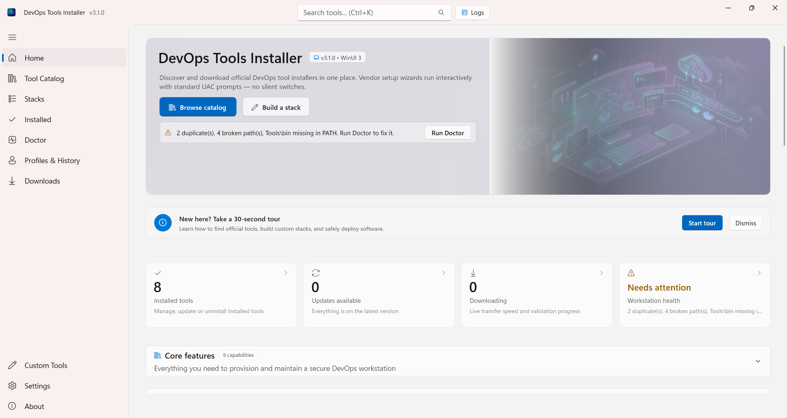

# DevOps Tools Installer — Static Marketing Website

A high-performance, minimalist, black-and-white static marketing website for **DevOps Tools Installer** (native Windows 11 WinUI 3 app). Built with pure HTML5 and CSS3, zero external dependencies, zero build steps, and an engineering-grade technical border design theme.

---

## 📁 Folder Structure

```text
web/
├── index.html                   # Homepage (Hero, Tool Wall, How It Works, Features, Principles, Comparison)
├── catalog.html                # Live tool catalog: 90 tools with vendor logos, search/filter, 12 stacks
├── features.html                # Detailed feature showcase with technical mockups
├── security.html                # 6-stage zero-trust verification pipeline & negative guarantees
├── cli.html                     # Headless CLI command reference & automation examples
├── download.html                # Distribution channels, system requirements, checksum verification
├── faq.html                     # 12-question accordion (safe, zero silent installs, zero telemetry)
├── favicon.svg                  # Minimalist black & white technical icon
├── robots.txt                   # Search crawler directives and sitemap reference
├── sitemap.xml                  # XML sitemap for SEO discovery
├── README.md                    # This website documentation
└── assets/
    ├── banner.png               # Banner graphic
    ├── catalog.json             # Site payload exported from the signed catalog (tools, stacks, categories)
    ├── css/
    │   └── style.css            # Single stylesheet (tokens, reset, base, layout, components, utilities, pages)
    ├── img/
    │   ├── logo.svg             # Technical wordmark logo with corner ticks
    │   ├── app-mockup.svg       # WinUI 3 application interface blueprint placeholder
    │   ├── feature-stacks.svg   # Custom Stack Builder 2-column composer mockup
    │   ├── feature-doctor.svg   # Workstation Doctor 5-point environment diagnostics mockup
    │   ├── feature-drawer.svg   # Universal Live Log Drawer (Ctrl+`) mockup
    │   ├── security-pipeline.svg # 6-stage cryptographic verification pipeline diagram
    │   ├── Homepage.png         # Real app capture — home dashboard
    │   ├── Tool-Catalog.png     # Real app capture — tool catalog
    │   ├── Stacks.png           # Real app capture — stacks
    │   ├── Downloads.png        # Real app capture — downloads & deployments
    │   ├── Installed.png        # Real app capture — installed inventory
    │   ├── Profiles&History.png # Real app capture — profiles & history
    │   ├── Doctor.png           # Real app capture — workstation doctor
    │   ├── Custom-tools.png     # Real app capture — custom tools editor
    │   ├── Settings.png         # Real app capture — settings
    │   ├── About.png            # Real app capture — about
    │   └── *.webp               # Generated WebP variants (see below)
    └── logos/                   # 90 vendor logo SVGs (copied from the app's Assets/logos)
```

---

## 🧩 Keeping the site catalog in sync

`catalog.html` and the homepage tool wall render from `web/assets/catalog.json`, which is
**generated from the signed catalog** — never hand-edited. Regenerate it after any catalog
change (the Catalog Refresh Bot workflow does this automatically):

```powershell
pwsh -File catalog/export-site-catalog.ps1
```

The script:

1. Copies every vendor logo from `src/DevOpsToolsInstaller/Assets/logos` into `web/assets/logos`.
2. Writes `web/assets/catalog.json` with the trimmed payload the site needs
   (`id`, `name`, `category`, `version`, `kind`, `description`, `homepage`, `logo`) plus the
   12 curated stacks from `catalog/bundles.json`.

> **Note on colour:** the site is otherwise strictly monochrome. Vendor logos are the single
> exception — they keep their brand colours inside a monochrome frame so the tools stay
> instantly recognisable.

---

## 🖼️ Image pipeline (WebP + lazy loading)

The application screenshots are served as **WebP with a PNG fallback**, at two widths, and are
lazy-loaded because they sit below the fold:

```html
<picture>
  <source type="image/webp" srcset="assets/img/Homepage-960.webp 960w, assets/img/Homepage.webp 1920w"
          sizes="(max-width: 768px) 100vw, 520px">
  
</picture>
```

- A phone downloads the **960w** variants — about **237 KB** for the whole tour instead of 1.6 MB.
- Desktop (or any 2× display) pulls the 1920w variants; a browser without WebP falls back to PNG.
- `banner.png` is intentionally **not** converted — it is the `og:image` social preview, and
  crawlers expect PNG/JPEG.

Regenerate the variants after replacing a screenshot:

```powershell
pip install pillow
python web/tools/optimize-images.py
```

The script writes `web/assets/img/<name>.webp` (1920w) and `<name>-960.webp` (960w) and prints
the before/after sizes.

---

## 🎨 Design Tokens

The site strictly enforces a monochrome technical design system with high-contrast (AA+) typography, zero border-radii, and signature drawing borders.

### Color Tokens

| Token | Light Value | Dark Value (`prefers-color-scheme` / `[data-theme]`) | Description |
| :--- | :--- | :--- | :--- |
| `--ink` | `#0a0a0a` | `#fafafa` | Primary foreground, solid buttons, headings, heavy borders |
| `--paper` | `#fafafa` | `#0a0a0a` | Primary background, inverted text color |
| `--mute` | `#6b6b6b` | `#999999` | Secondary text, micro-labels, metadata |
| `--line` | `#d9d9d9` | `#262626` | Subtle dividers, grid lines, structural frames |

*Note: No accent colors are used anywhere. Visual hierarchy is established solely through weight, inversion, scale, and border styles.*

### Typography Tokens

| Token | Stack / Value | Line Height | Usage |
| :--- | :--- | :--- | :--- |
| `--font-mono` | `ui-monospace, "SF Mono", "Cascadia Code", Consolas, monospace` | `1.15 - 1.35` | Headings, code, badges, buttons, micro-labels |
| `--font-body` | `system-ui, -apple-system, "Segoe UI", Roboto, sans-serif` | `1.5` | Body prose, tables, descriptions |
| `--font-display` | `clamp(2.15rem, 4.5vw + 1rem, 3.75rem)` | `1.1` | Hero display heading |
| `--font-h1` | `clamp(1.75rem, 3vw + 0.8rem, 2.5rem)` | `1.15` | Page titles (`<h1>`) |
| `--font-h2` | `clamp(1.35rem, 2vw + 0.6rem, 1.85rem)` | `1.25` | Section titles (`<h2>`) |
| `--font-h3` | `clamp(1.1rem, 1.2vw + 0.5rem, 1.35rem)` | `1.35` | Card titles (`<h3>`) |
| `--font-base` | `clamp(0.95rem, 0.4vw + 0.85rem, 1.05rem)` | `1.5` | Standard body copy |
| `--font-small` | `clamp(0.78rem, 0.2vw + 0.72rem, 0.875rem)` | `1.4` | Table data, footnotes, nav links |
| `--font-micro` | `clamp(0.68rem, 0.15vw + 0.65rem, 0.75rem)` | `1.2` | Monospace tags with `letter-spacing: 0.08em` |

### Spacing Tokens (8px Base Unit)

| Token | Value | Token | Value |
| :--- | :--- | :--- | :--- |
| `--space-1` | `8px` | `--space-4` | `32px` |
| `--space-2` | `16px` | `--space-6` | `48px` |
| `--space-3` | `24px` | `--space-8` | `64px` |

### Signature Border Themes

1. **Corner Ticks (`.corner-box`)**: 10px L-shaped corner marks created using 8 CSS `linear-gradient` background layers on a single element. No full border.
2. **Double Rule (`.double-rule`)**: Technical drawing section dividers featuring two 1px solid lines with a 3px gap (`height: 5px; border-top: 1px; border-bottom: 1px`).
3. **Offset Frame (`.offset-frame`)**: 1px solid box with a secondary 1px outline offset by 8px via `::after`. Shifts smoothly by 4px on hover.
4. **Dashed to Solid (`.btn-secondary`, `.theme-toggle-btn`)**: 1px dashed border by default that converts to solid with an inverted fill on hover/focus.
5. **Index Rail (`.index-rail`)**: 1px vertical guide rail running down long sections with bracketed monospace square markers (e.g. `[01]`, `[02]`).

---

## ➕ How to Add a New Page

To add a new page (e.g., `docs.html`):

1. **Duplicate Page Template**: Copy `faq.html` or `security.html` to `docs.html`.
2. **Update Document Metadata**:
   - Update `<title>` with a unique, descriptive page title.
   - Update `<meta name="description">` and Open Graph (`og:title`, `og:description`, `og:url`).
   - Update `<link rel="canonical" href="https://notharshhaa.github.io/DevOpsToolsInstaller/docs.html">`.
3. **Update Navigation Link**:
   - In `<nav id="site-nav">`, locate the link to the new page.
   - Add `aria-current="page"` to the current page's `<a>` tag:
     ```html
     <li><a href="docs.html" class="nav-link" aria-current="page">Docs</a></li>
     ```
   - Ensure all other navigation links do **not** have `aria-current="page"`.
4. **Update Breadcrumb**:
   - Adjust `<ol class="breadcrumb-list">`:
     ```html
     <li class="breadcrumb-item"><a href="index.html" class="breadcrumb-link">Home</a></li>
     <li class="breadcrumb-item" aria-current="page">Docs</li>
     ```
5. **Add Main Landmark & Content**:
   - Add a single `<h1>` inside the first `<section>`.
   - Wrap sections in `<div class="index-rail">` with numbered markers like `[01]`, `[02]` for visual consistency.
   - Use `.corner-box` for cards and content blocks.
6. **Register in `sitemap.xml`**:
   - Add a new `<url>` entry with appropriate `<changefreq>` and `<priority>`.

---

## 🚀 How to Deploy to GitHub Pages

The repository contains an automated GitHub Actions deployment workflow at `.github/workflows/pages.yml`.

### Minimal GitHub Actions Workflow (`.github/workflows/pages.yml`)

```yaml
name: Deploy Static Website to GitHub Pages

on:
  push:
    branches:
      - master
    paths:
      - '**.html'
      - 'assets/**'
      - 'favicon.svg'
      - 'robots.txt'
      - 'sitemap.xml'
  workflow_dispatch:

permissions:
  contents: read
  pages: write
  id-token: write

concurrency:
  group: 'pages'
  cancel-in-progress: true

jobs:
  deploy:
    environment:
      name: github-pages
      url: ${{ steps.deployment.outputs.page_url }}
    runs-on: ubuntu-latest
    steps:
      - name: Checkout
        uses: actions/checkout@v4

      - name: Setup Pages
        uses: actions/configure-pages@v5

      - name: Upload Pages Artifact
        uses: actions/upload-pages-artifact@v3
        with:
          path: '.'

      - name: Deploy to GitHub Pages
        id: deployment
        uses: actions/deploy-pages@v4
```

### Enabling GitHub Pages in Repository Settings:
1. Open the repository on GitHub: `https://github.com/NotHarshhaa/DevOpsToolsInstaller`.
2. Go to **Settings &rarr; Pages**.
3. Under **Build and deployment &rarr; Source**, select **GitHub Actions**.
4. Pushing to `master` will now automatically deploy the website.
